# Architecture

```mermaid
flowchart LR
  D[Virtual devices] --> S[Sensor simulator]
  S --> E[DES-CBC envelope]
  E --> H[HMAC-SHA256]
  H --> P[Mosquitto publisher]
  P --> B[Mosquitto broker]
  B --> R[Receiver]
  R --> V[Schema and device validation]
  V --> A[HMAC verification]
  A --> Q[Persistent replay check]
  Q --> X[DES decryption]
  X --> DB[(SQLite)]
  DB --> UI[Streamlit dashboard]
```

The envelope contains protocol version, algorithm identifier, device ID, sequence number, IV, Base64 ciphertext and HMAC. The HMAC covers every field except itself. Verification is performed before decryption. Replay state is per device and stored in SQLite.
